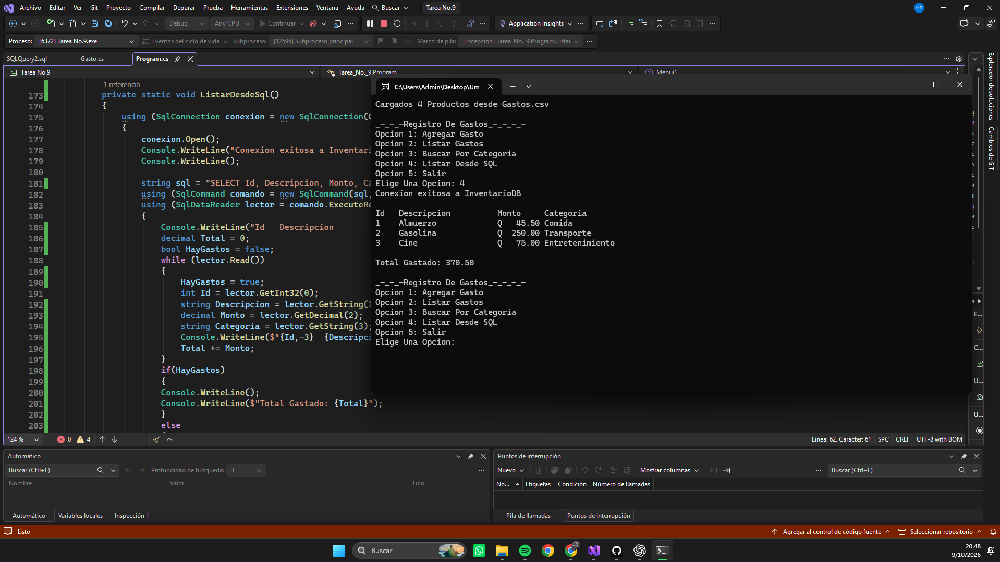
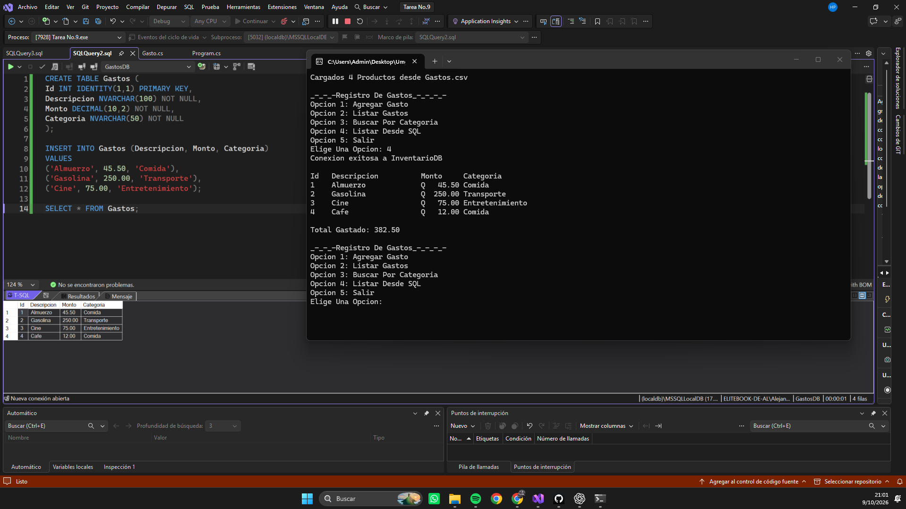
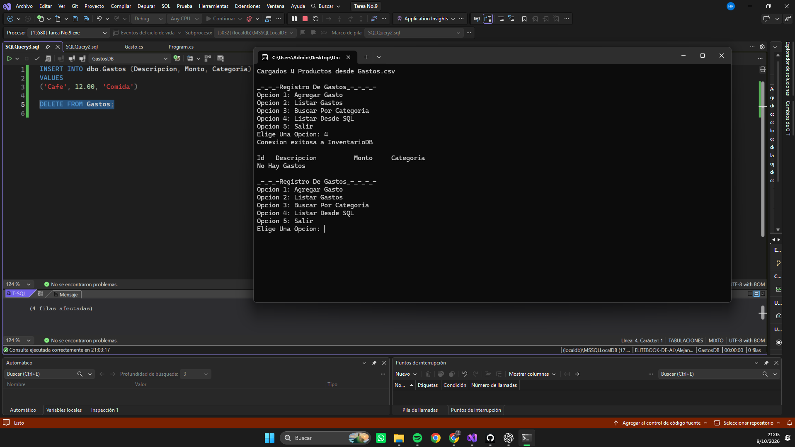
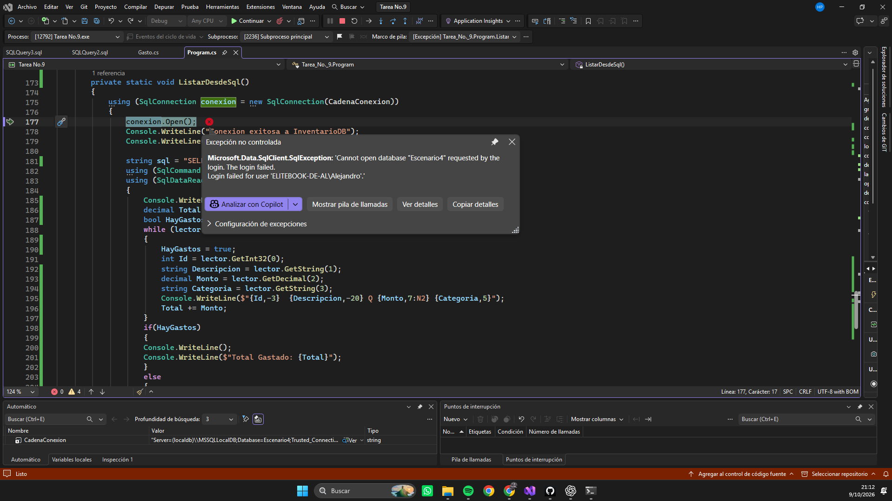

# Tarea 9 Conexión a Base de datos y lectura de registros

## Descripción

Programa desarrollado en C# que utiliza:

- Cadena de conexion a Base de datos
- Create table
- Consulta en SQL
- tipos de datos (INT, NVARCHAR, DECIMAL)
- Primary Key
- INSERT INTO VALUES
- DELETE FROM
- Creacion de GastosDB en (localdb)\MSSQLLocalDB
- using
- SqlConnection
- SqlCommand
- SqlDataReader
- .ExecuteReader()
- .Read
- .GetInt32()
- .GetString()
- .GetDecimal()
- Interpolacion
- if y else

## Cómo ejecutar

- Abrir el proyecto en Visual Studio Community.
- Presionar **F5**.

O desde la terminal:

## Capturas
- 3 primeros Gastos Ejecutados

- Agregado Con SQL nuevo gasto 

- Elimando Gastos y muestra no hay Gastos

- SqlException

## Porque muestra el error?
_ Porque la cadena de conexion le pide a SQL que abra una Base de datos llamada Escenario4 la cual no existe y por eso la conexion no puede abrirse porque le estamos pidiendo que entre a algo que no existe